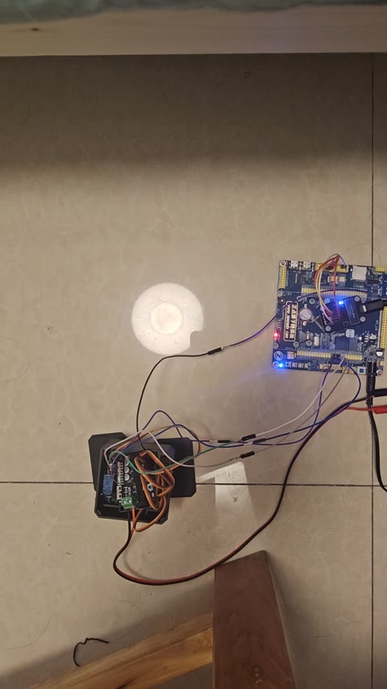

# Micro Duck Mini: STM32 and FreeRTOS Learning Journal

This repository documents my personal embedded-systems learning process: experiments, evolving code, debugging decisions, and study notes. It is a student learning project, developed step by step rather than a finished robotics product or a ready-to-run tutorial.

The initial inspiration was Microduck. The actual learning platform uses the four-servo **Otto DIY Classic / V9** mechanical design, an **STM32F103ZET6**, and **FreeRTOS**. My focus is learning embedded software while reusing an existing mechanical structure.

## Current status

**Development is paused as of October 16, 2026. The current snapshot does not compile because pause/resume changes are only partially implemented.**

I am keeping the unfinished code and its exact stopping point so I can return to the project later. Earlier versions produced physical servo motion, walking, and left/right turns in my experiments. Those observations do not validate this unfinished snapshot.

| Area | Progress |
| --- | --- |
| Four-channel hardware PWM | Implemented in the project |
| Joint mapping, center offsets, and output limits | Configured in software |
| Timed four-servo interpolation | Implemented |
| Motion sequences and action switching | Integrated into the task code |
| Walking and left/right turns | Reported working in earlier physical experiments |
| Segment-boundary pause and resume | Partially edited; currently broken |
| Command queue and serial control | Discussed, not implemented |
| Calibration persistence and sensor feedback | Not implemented |

The incomplete edits include a `PAUSE` / `PAUSED` enum mismatch, missing sequence pause/resume definitions, and unfinished functions at the end of `robot_action.c`. A syntax check using the existing ARM GCC confirmed errors. No full build or hardware test was performed for this checkpoint.

## Hardware demo

[](media/micro-duck-demo.mp4)

[Watch or download the original demo video](media/micro-duck-demo.mp4) — MP4, approximately 20.6 seconds, 46.5 MiB.

This recording is part of my hands-on learning record. The firmware revision used for the recording was not identified, so it does not establish that the unfinished pause/resume code in this snapshot works. The original video is preserved without re-encoding.

## Hardware and tools

- STM32F103ZET6 development board: ALIENTEK Elite board.
- Four SG90 position servos and Otto DIY printed parts.
- DAP-Link for SWD debugging.
- STM32CubeIDE 2.2.0, GCC, and STM32CubeF1 HAL.
- FreeRTOS V10.3.1 with CMSIS-RTOS v2, the Cortex-M3 port, and `heap_4`.
- TIM3: four 50 Hz PWM outputs, with a 1 microsecond counter tick.
- TIM1 provides the HAL time base; SysTick provides the RTOS tick.

Joint assignments are CCR1/PA6 = right leg, CCR2/PA7 = left leg, CCR3/PB0 = left foot, and CCR4/PB1 = right foot. Left and right are defined from the robot's own perspective, with the `otto.com` side facing forward.

Candidate center pulse widths are 1900, 1500, 1500, and 1400 microseconds. The configured joint windows are each center plus or minus 1000 microseconds, with a driver-wide window of 400–2900 microseconds. These are software settings, not measured mechanical safety limits for other builds.

## What I am learning

- Hardware timers, PWM, HAL interfaces, and board-level driver organization.
- FreeRTOS task creation, periodic scheduling, stack settings, and task ownership.
- C enums, structures, pointers, linkage, data lifetime, and short critical sections.
- Non-blocking control with request functions and periodic update functions.
- Coordinated servo commands, calibration offsets, and time-based interpolation.
- Action switching, stopping, pausing, resuming, and handling conflicting requests.
- Separating a design idea, implemented code, compilation evidence, and physical observations.

The robot currently uses open-loop commands at the STM32 level. `current_pose` records the last commanded pulse widths; it does not measure the physical joint positions. Walking direction is affected by the environment, and no heading or balance feedback controller is implemented.

## Code organization

```text
MicroDuck_F103_FreeRTOS/
  Core/Inc/ and Core/Src/
    servo_task       periodic execution and temporary test requests
    robot_action     action tables and pending action switching
    motion_sequence  segment progression and playback state
    servo_control    calibrated, timed four-servo interpolation
  Drivers/BSP/
    servo_pwm        TIM3 PWM output
  Drivers/ and Middlewares/
    STM32 HAL, CMSIS, and FreeRTOS
3D代打_原始Otto_V9/    mechanical reference files and printing notes
media/               original hardware demo and a preview image
项目现状.md           detailed project status and restart checklist
答疑.md               concepts, explanations, and learning notes
```

The servo task is intended to run every 20 ms. Its current source generates temporary test requests and then calls:

```c
ServoControl_Update(now_ms);
MotionSequence_Update();
RobotAction_Update();
```

There are two application tasks: heartbeat and servo control. The action and sequence modules are regular C modules, not additional RTOS tasks. The current test script requests walking at approximately 1 second, a left turn at 4 seconds, and a segment-boundary stop at 7 seconds.

## Notes and continuation

Most study notes are in Chinese:

- [Project status and unfinished edits](项目现状.md): start with sections 0, 12, and 13.
- [Questions and learning notes](答疑.md): sections 45–52 explain the latest state-machine discussions.

The repository preserves earlier stages of learning. Older notes may describe code or parameters from an earlier stage; the dated project checkpoint and actual source take precedence.

To inspect the project, import `MicroDuck_F103_FreeRTOS` into STM32CubeIDE using **Existing Projects into Workspace**. Before building or running, finish the documented pause/resume edits. The next planned work is a small action-state query, a FreeRTOS command queue, and a simple serial command interface. Finite action repetition, command-speed constraints, and persistent calibration remain later ideas.

Generated build output and local IDE workspace caches are excluded from version control. The checkpoint is a work-in-progress record, not a release.

## References and attribution

- [Otto DIY mechanical reference](https://github.com/angelmicelti/OttoDIY/tree/master/OTTO_V02_BOM_STP_STL)
- [OttoDIYLib](https://github.com/OttoDIY/OttoDIYLib)

Otto DIY provides the mechanical reference and inspiration for four-servo movement. STM32 HAL, CMSIS, and FreeRTOS are third-party components and retain their upstream license notices. This repository records my learning work; it does not claim authorship of those components or of the Otto mechanical design. No new blanket license is assigned to the entire repository by this checkpoint.
